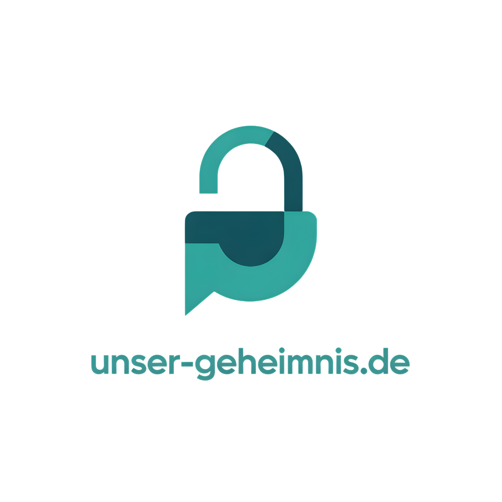

<div align="center">



# unser-geheimnis.de

**Teile sensible Daten. Verschlüsselt. Einmalig. Spurlos.**

[](LICENSE)
[](https://nextjs.org)
[](https://typescriptlang.org)
[](#dsgvo-konformität)
[](#architektur-zero-knowledge-design)

</div>

---

## Was ist unser-geheimnis.de?

**unser-geheimnis.de** ist ein hochseriöser, DSGVO-konformer Webdienst zum sicheren Teilen von Zugangsdaten, Passwörtern, API-Keys und Dateien (bis 16 MB). Der Dienst arbeitet nach dem Prinzip:

> **Erstellen → Link teilen → Empfänger öffnet → Geheimnis wird unwiderruflich gelöscht.**

Der entscheidende Unterschied zu vergleichbaren Diensten: **Zero-Knowledge-Architektur**. Der Entschlüsselungsschlüssel verlässt deinen Browser nie — er existiert ausschließlich im URL-Fragment (`#key`), das der Browser standardmäßig nicht an den Server überträgt. Selbst der Betreiber kann gespeicherte Geheimnisse technisch nicht entschlüsseln.

---

## Kernprinzipien

| Prinzip | Beschreibung |
|---|---|
| **Ende-zu-Ende-Verschlüsselt** | AES-256-GCM im Browser via Web Crypto API — der Server sieht nur verschlüsselte Blobs |
| **Admin-Proof (Zero Trust)** | Schlüssel existiert ausschließlich im URL-Fragment — kein Admin, kein Hacker, kein Gericht kann entschlüsseln |
| **DSGVO-konform** | Keine IP-Speicherung, kein Tracking, kein Analytics, keine Cookies, DE-Hosting |
| **Burn-After-Read** | Automatische unwiderrufliche Löschung nach dem ersten Abruf |
| **Kein Tracking** | Kein Google Analytics, keine Cookies, kein Fingerprinting, keine externen Ressourcen |
| **Open Source** | Vollständig öffentlicher Quellcode — überprüfbar, auditierbar, selbst hostbar |

---

## Features

- **Texte & Dateien** — Passwörter, API-Keys, Notizen oder Dateien bis 16 MB
- **Ablaufzeiten** — Wählbar: 1, 2, 4, 8, 12, 24 oder 48 Stunden
- **Burn-After-Read** — Sofort nach dem ersten Abruf gelöscht (default: an)
- **Optionaler Passwortschutz** — Zusätzliche Absicherung per PBKDF2 + AES-GCM
- **QR-Code-Generierung** — Für einfaches Teilen zwischen Geräten
- **Automatischer Cleanup** — Cron-Job löscht abgelaufene Geheimnisse minütlich
- **Sichere Löschung** — Dateien werden vor dem Löschen mit Zufallsdaten überschrieben
- **Animierte UI** — Hochwertige Animationen mit Framer Motion
- **Vollständig Deutsch** — UI, Datenschutz, Impressum, SEO-optimiert

---

## Architektur: Zero-Knowledge-Design

```
┌─────────────────────────────────────────────────────────────────────┐
│  BROWSER (Ersteller)                                                │
│                                                                     │
│  1. Eingabe → 2. Schlüssel generieren (256-bit AES-GCM)            │
│  3. Clientseitig verschlüsseln (Web Crypto API)                    │
│  4. Nur verschlüsseltes Blob an Server senden                      │
│  5. Link: https://unser-geheimnis.de/s/{id}#{schlüssel}            │
│     └── #schlüssel wird NIE an den Server gesendet                 │
└─────────────────────────────────────────────────────────────────────┘
                              │
                    [ Verschlüsselter Blob ]
                              │
                              ▼
┌─────────────────────────────────────────────────────────────────────┐
│  SERVER                                                             │
│                                                                     │
│  Speichert: { id, encryptedBlob, iv, expiresAt }                   │
│  Sieht: verschlüsselte Bytes — ohne jeden Wert ohne den Schlüssel  │
│  Weiß NICHT: wer, was, wohin, wann — keine personenbezogenen Daten │
└─────────────────────────────────────────────────────────────────────┘
                              │
                    [ Verschlüsselter Blob ]
                              │
                              ▼
┌─────────────────────────────────────────────────────────────────────┐
│  BROWSER (Empfänger)                                                │
│                                                                     │
│  1. Schlüssel aus URL-Fragment extrahieren                         │
│  2. Verschlüsseltes Blob vom Server abrufen                        │
│  3. Clientseitig entschlüsseln                                     │
│  4. Klartext nur im Browser — Server löscht Geheimnis sofort       │
└─────────────────────────────────────────────────────────────────────┘
```

---

## Tech-Stack

| Schicht | Technologie |
|---|---|
| **Frontend** | Next.js 16, React 19, TypeScript 5 |
| **Styling** | Tailwind CSS 4, Framer Motion 12 |
| **Verschlüsselung** | Web Crypto API (AES-256-GCM, PBKDF2) |
| **Backend** | Next.js API Routes (Node.js) |
| **Datenbank** | SQLite (Dev) / PostgreSQL (Prod) via Prisma ORM |
| **Validierung** | Zod |
| **ID-Generierung** | CUID2 (kollisionsresistent, nicht erratbar) |
| **Scheduler** | node-cron (automatischer Cleanup) |

---

## Schnellstart

### Voraussetzungen

- Node.js 20+
- npm oder pnpm

### Installation

```bash
# Repository klonen
git clone https://github.com/dein-user/unser-geheimnis-de.git
cd unser-geheimnis-de

# Abhängigkeiten installieren
npm install

# Umgebungsvariablen konfigurieren
cp .env.example .env
# → .env anpassen (DATABASE_URL, NEXT_PUBLIC_SITE_URL)

# Datenbank initialisieren
npx prisma migrate dev --name init

# Entwicklungsserver starten
npm run dev
```

Öffne [http://localhost:3000](http://localhost:3000) im Browser.

---

## Umgebungsvariablen

Alle verfügbaren Variablen sind in [`.env.example`](.env.example) dokumentiert.

| Variable | Beschreibung | Beispiel |
|---|---|---|
| `DATABASE_URL` | Datenbank-Verbindungs-URL | `file:./dev.db` |
| `NEXT_PUBLIC_SITE_URL` | Öffentliche URL der Seite | `https://unser-geheimnis.de` |
| `NODE_ENV` | Umgebung | `development` / `production` |
| `RATE_LIMIT_MAX` | Max. Anfragen pro IP/Stunde | `10` |
| `MAX_FILE_SIZE_MB` | Max. Dateigröße in MB | `16` |
| `UPLOAD_DIR` | Pfad für verschlüsselte Dateien | `./data/secrets` |
| `APP_SECRET` | **Pflicht für „Daten anfordern“ per E-Mail.** Schlüssel für HMACs (Codes, PoW, E-Mail-Hashes), mind. 32 Zeichen. Erzeugen: `openssl rand -hex 32` | `9f2c…` |
| `SMTP_HOST` | SMTP-Server für E-Mails (ohne: E-Mail-Versand in Produktion deaktiviert) | `smtp.example.de` |
| `SMTP_PORT` | SMTP-Port (587 = STARTTLS erzwungen, 465 = TLS) | `587` |
| `SMTP_USER` / `SMTP_PASS` | SMTP-Zugangsdaten | |
| `MAIL_FROM` | Absender der E-Mails | `unser-geheimnis.de <noreply@unser-geheimnis.de>` |
| `MAIL_DAILY_LIMIT` | Globale Obergrenze Einladungen pro Tag | `300` |

### Daten anfordern: Missbrauchsschutz

- **Double-Opt-in:** Einladung an den Empfänger erst nach Bestätigung der Absenderadresse (6-stelliger Code oder Link; 30 Min. gültig, max. 5 Versuche). Der Bestätigungslink löst nichts beim bloßen Öffnen aus (Schutz vor Mail-Scannern).
- **Proof-of-Work** (ALTCHA-Prinzip, selbst gehostet): HMAC-signiert, an die IP gebunden, einmalig, 5 Min. gültig; die Schwierigkeit steigt mit der Aktivität der IP.
- **Rate-Limits** (DB, HMAC-pseudonymisiert): pro IP 5/h und 15/Tag, pro Absender 3/h und 10/Tag, pro Empfänger 3/Tag, global `MAIL_DAILY_LIMIT`.
- **Abmeldung/Sperrliste** per signiertem Link in jeder Mail (auch für fälschlich eingetragene Absender).
- **Inhalt:** keine Links/Domains in Name und Nachricht, nur Links auf die eigene Domain, Hinweis „Domain prüfen“ und „im Zweifel ignorieren“; Honeypot gegen einfache Bots.

---

## Deployment (Produktion)

### Mit PM2

```bash
# Produktionsbuild erstellen
npm run build

# Mit PM2 starten
npm install -g pm2
pm2 start ecosystem.config.js
pm2 save
pm2 startup
```

### Nginx-Konfiguration

```nginx
server {
    listen 443 ssl http2;
    server_name unser-geheimnis.de;

    ssl_certificate     /etc/letsencrypt/live/unser-geheimnis.de/fullchain.pem;
    ssl_certificate_key /etc/letsencrypt/live/unser-geheimnis.de/privkey.pem;

    # DSGVO: Kein Request-Body in Logs
    access_log off;
    error_log /var/log/nginx/error.log error;

    location / {
        proxy_pass http://localhost:3000;
        proxy_http_version 1.1;
        proxy_set_header Upgrade $http_upgrade;
        proxy_set_header Connection 'upgrade';
        proxy_set_header Host $host;
        proxy_set_header X-Forwarded-For $remote_addr;
        proxy_cache_bypass $http_upgrade;
    }
}
```

> **Hosting-Empfehlung:** Hetzner Cloud (DE), Netcup (DE) oder eigene Infrastruktur.
> Daten sollten in der EU bleiben (DSGVO). Kein Vercel/Netlify für Produktivdaten (US-Unternehmen).

---

## Sicherheitsarchitektur

### Was der Server speichert

```
id:            "clx7f9k2a0001..."   ← Öffentliche ID (in URL)
encryptedData: <binärer Blob>       ← AES-256-GCM Ciphertext — NICHT entschlüsselbar
iv:            <12 Bytes>           ← Initialization Vector
type:          "TEXT" | "FILE"
expiresAt:     "2026-03-27T14:00:00Z"
```

### Was der Server NICHT weiß

```
❌  Entschlüsselungsschlüssel  (lebt nur im URL-Fragment beim Nutzer)
❌  Klartext des Geheimnisses
❌  IP-Adresse des Erstellers oder Empfängers
❌  Wer das Geheimnis erstellt hat
❌  Wer es abgerufen hat
❌  Inhalt der geteilten Dateien
```

### Security Headers (alle Requests)

- `Content-Security-Policy` — Nur self-hosted Ressourcen, kein CDN
- `Strict-Transport-Security` — HSTS, 1 Jahr, preload
- `X-Frame-Options: DENY` — Kein iFrame-Embedding
- `Referrer-Policy: no-referrer` — Keine Referrer-Leaks
- `X-Content-Type-Options: nosniff`

---

## Datenbankschema

```prisma
model Secret {
  id            String    @id @default(cuid())
  encryptedData Bytes                           // AES-256-GCM Ciphertext
  iv            Bytes                           // 12-Byte IV
  type          String                          // "TEXT" | "FILE"
  fileName      String?
  fileSize      Int?
  mimeType      String?
  expiresAt     DateTime
  burnAfterRead Boolean   @default(true)
  readCount     Int       @default(0)
  createdAt     DateTime  @default(now())

  // KEINE IP, KEINE Nutzerinfos, KEIN Tracking
  @@index([expiresAt])
}
```

---

## DSGVO-Konformität

- **Keine personenbezogenen Daten** — Keine IP, keine E-Mail, kein Tracking
- **Automatische Löschung** — Secrets werden nach TTL oder nach dem Lesen gelöscht
- **Sichere Löschung** — Dateien werden vor dem Unlink mit Zufallsdaten überschrieben
- **Kein Google Fonts CDN** — Alle Schriften lokal gehostet
- **Keine externen Ressourcen** — Kein Analytics, kein Pixel, kein CDN
- **Transparente Datenschutzerklärung** — Unter `/datenschutz`
- **Impressum** — Unter `/impressum` (Pflicht nach §5 TMG/DDG in DE)
- **Rate-Limiting ohne Persistenz** — IP nur im RAM, nicht gespeichert

---

## Projektstruktur

```
unser-geheimnis-de/
├── src/
│   ├── app/
│   │   ├── page.tsx                  ← Landing Page & Ersteller
│   │   ├── s/[id]/page.tsx           ← Empfänger-Ansicht (noindex)
│   │   ├── datenschutz/page.tsx      ← DSGVO-Datenschutzerklärung
│   │   ├── impressum/page.tsx        ← Impressum
│   │   ├── so-funktionierts/page.tsx ← Technische Erklärung (SEO)
│   │   ├── fuer-unternehmen/page.tsx ← B2B-Seite
│   │   └── api/
│   │       ├── secrets/route.ts      ← POST: Geheimnis erstellen
│   │       └── secrets/[id]/route.ts ← GET: Abrufen + löschen
│   ├── components/ui/
│   │   ├── SecretCreator.tsx         ← Hauptformular (Text & Datei)
│   │   ├── SecretRevealer.tsx        ← Entschlüsselung & Anzeige
│   │   ├── ExpirySelector.tsx        ← TTL-Auswahl
│   │   ├── LinkDisplay.tsx           ← Link + QR-Code
│   │   ├── Navbar.tsx
│   │   └── Footer.tsx
│   ├── lib/
│   │   ├── crypto.ts                 ← AES-256-GCM Verschlüsselung (Kern!)
│   │   ├── validation.ts             ← Zod-Schemas
│   │   └── constants.ts
│   └── server/
│       ├── db.ts                     ← Prisma Client Singleton
│       ├── cleanup.ts                ← Automatischer Cron-Cleanup
│       └── storage.ts                ← Sichere Datei-Löschung
├── prisma/
│   └── schema.prisma
├── public/
├── .env.example                      ← Vorlage für Umgebungsvariablen
└── ecosystem.config.js               ← PM2-Produktionskonfiguration
```

---

## Verwandte Projekte

| Projekt | Unterschied |
|---|---|
| [OneTimeSecret](https://github.com/onetimesecret/onetimesecret) | Serverseitige Verschlüsselung, US-Hosting |
| [PrivateBin](https://github.com/PrivateBin/PrivateBin) | Fokus auf Texte/Code, kein Datei-Upload bis 16 MB |
| [Yopass](https://github.com/jhaals/yopass) | Ähnliches Konzept, weniger DSGVO-Fokus |

**unser-geheimnis.de** unterscheidet sich durch: Zero-Knowledge im Browser, Admin-Proof-Architektur, vollständige DSGVO-Konformität, DE-Hosting-Empfehlung und hochwertige animierte UI.

---

## Mitwirken

Beiträge sind willkommen!

1. Fork erstellen & Feature-Branch anlegen: `git checkout -b feature/mein-feature`
2. Änderungen committen: `git commit -m 'feat: neue Funktion'`
3. Branch pushen: `git push origin feature/mein-feature`
4. Pull Request öffnen

**Wichtig:** Sicherheitsrelevante Änderungen (insbesondere `src/lib/crypto.ts`) bitte besonders sorgfältig begründen.

**Sicherheitslücken** bitte nicht öffentlich als Issue melden — stattdessen direkt per E-Mail an den Maintainer.

---

## Lizenz

MIT License — siehe [LICENSE](LICENSE)

---

<div align="center">

Made with AI 🤖 & ♥ in Deutschland &nbsp;|&nbsp; [unser-geheimnis.de](https://unser-geheimnis.de) &nbsp;
</div>
